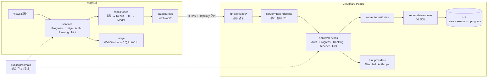

# 아키텍처

code.ai 는 Cloudflare Pages 하나로 동작합니다. 정적 화면(`public/`)과 API(`functions/` → `server/`), 데이터베이스(D1)가 같은 주소에서 돌아갑니다. C 코드 실행과 채점은 서버가 아니라 **학생의 브라우저**에서 합니다.

## 왜 이렇게 나눴나

- **채점은 브라우저에서**: 서버에서 학생 코드를 돌리면 보안(샌드박스)과 비용 문제가 크다. 인터프리터는 gcc와 결과가 같도록 242개 테스트로 검증한다.
- **규칙은 한 곳에**: 경험치·레벨·클리어·진화 규칙은 `public/js/domain/` 에 순수 함수로 두고 서버와 화면이 같은 파일을 쓴다. 서버는 화면이 보낸 경험치를 믿지 않고 이 규칙으로 다시 계산한다.
- **계층 분리**: DataSource만 바꾸면 D1을 다른 DB로, Provider만 바꾸면 다른 AI 서비스로 갈아 끼울 수 있다 (DIP, OCP).
- **조립은 두 곳**: `public/js/main.js`(화면), `server/container.js`(서버). 테스트는 여기서 가짜 객체를 주입한다.

## 데이터

| 테이블 | 내용 |
|---|---|
| `users` | 아이디, 닉네임, 비밀번호 해시(PBKDF2), 복구 코드 해시 |
| `sessions` | 세션 토큰 해시, 회원, 만료 시각 (30일) |
| `progress` | 진도 전체 JSON + 랭킹용 요약 칸(xp, level, form, solved_count …), 랭킹 참여 여부 |

진도 JSON 모양은 `public/js/domain/progress-model.js`, 정리 규칙은 `public/js/mappers/progress-mapper.js` 에 있습니다.

## API

| 주소 | 설명 | 로그인 |
|---|---|---|
| `POST /api/auth/signup` | 가입, 쿠키 + 복구 코드 | |
| `POST /api/auth/login` · `logout` | 로그인 · 로그아웃 | |
| `GET /api/auth/me` | 지금 회원 + 기능 스위치 | 필요 |
| `POST /api/auth/find-username` | 복구 코드 → 아이디 | |
| `POST /api/auth/reset-password` | 아이디 + 복구 코드 → 새 비밀번호, 새 코드 | |
| `POST /api/auth/recovery-code` | 복구 코드 새로 만들기 | 필요 |
| `POST /api/auth/nickname` | 닉네임 바꾸기 | 필요 |
| `GET` · `PUT /api/progress` | 진도 불러오기 · 저장 | 필요 |
| `GET /api/ranking` | 랭킹 (참여자만, 상위 100) | 필요 |
| `GET /api/teacher/students` | 학생 요약 (선생님만) | 필요 |
| `POST /api/hint` | AI 힌트 (꺼져 있으면 503) | 필요 |

## 알고 있는 한계

- 채점이 브라우저에서 일어나므로, 마음먹고 조작하면 "맞았다"는 기록을 서버에 보낼 수 있다. 학습용으로 받아들인 선택이고, 랭킹 대회용으로 쓰려면 서버 채점이 필요하다.
- 로그인·복구 코드 시도 횟수 제한이 아직 없다. 공개 운영 전에 Cloudflare Rate Limiting 규칙이나 Turnstile을 붙이는 것을 권장한다.
- 인터프리터는 C11의 학습용 부분집합이다 (goto, union 일부, 비트필드, C++ 문법 미지원).
